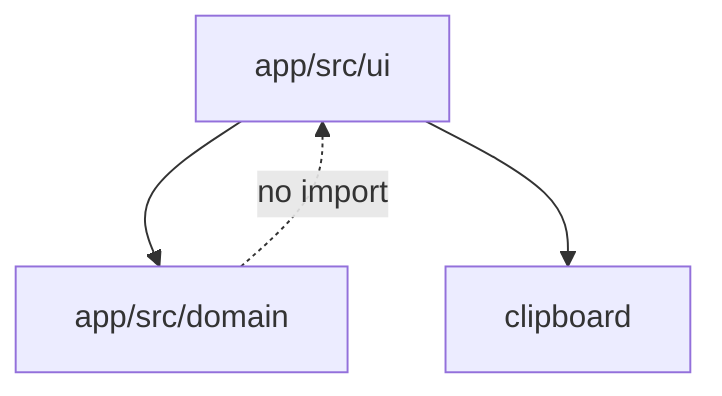

# Architecture Spine — Lista do Churras

## Design Paradigm

**Domain-centered.** `domain/` is a pure TypeScript module (no React, no I/O). UI may only call `calcularLista(input) -> Lista`. Recalculate = call again with current input; never fold a previous `Lista` into the next.



## Invariants & Rules

### AD-1 — Pure calculation [ADOPTED]

- **Binds:** FR-6, FR-7, FR-9, FR-10
- **Prevents:** UI accumulating totals (Bora bug)
- **Rule:** `calcularLista` is a pure function. The same input always yields the same `Lista`. UI must replace state with the new return value, never add field-wise to the previous `Lista`.

### AD-2 — No backend [ADOPTED]

- **Binds:** NFR-1, NFR-3, Pix-out-of-V1
- **Prevents:** cloud Pix, accounts, price tables
- **Rule:** No network required after install. Prices stay in component state. No analytics of prices.

### AD-3 — Meat section split [ADOPTED]

- **Binds:** FR-7
- **Prevents:** farofa eating the meat pie
- **Rule:** Percentages that sum to 100% exist only among selected cuts. Sides, charcoal, beer are independent recommended quantities.

### AD-4 — Expo as the RN starter [ADOPTED]

- **Binds:** NFR-4
- **Prevents:** bare RN / Flutter drift
- **Rule:** App lives in `app/` as Expo (TypeScript). Android first. Do not add a second mobile tree.

## Consistency Conventions

| Concern | Convention |
| --- | --- |
| Naming | Portuguese domain names in UI; English identifiers in code (`meatKg`, `hunger`) |
| Numbers | Domain uses SI (kg, L, hours). UI formats pt-BR (`1,5 kg`, `R$ 12,90`) |
| State | Single React state object `ChurrascoInput`; derived `Lista` via `calcularLista` |
| Tests | Domain tests run without Expo (`node --test` / tsx) |

## Stack

| Name | Version |
| --- | --- |
| TypeScript | 5.x (Expo pin) |
| Expo | SDK 57 (create-expo-app current) |
| React Native | Expo pin |
| Node test | Node 24 built-in test runner + tsx |

## Structural Seed

```text
app/
  App.tsx                 # root UI
  src/domain/             # pure core
    catalog.ts
    calculate.ts
    format.ts
    types.ts
  src/domain/*.test.ts
```

## Capability → Architecture Map

| Capability | Lives in | Governed by |
| --- | --- | --- |
| Recomendado / Carne / % | `calculate.ts` | AD-1, AD-3 |
| Recalcular | UI replace + pure fn | AD-1 |
| Preço / Total | UI + `totalEstimado` | AD-2 |
| Copiar Lista | `format.ts` + clipboard | NFR-2 |
| Anúncio | placeholder view | FR-13; AdMob deferred |

## Deferred

- AdMob / IAP billing SDK — after calculator is solid.
- Per-person hunger list.
- iOS project extras (Expo can compile later).
- Persist last churrasco (AsyncStorage) — not required for UJ-1.
- Android Studio / emulator — optional; Expo web + Expo Go suffice to prove the domain.
